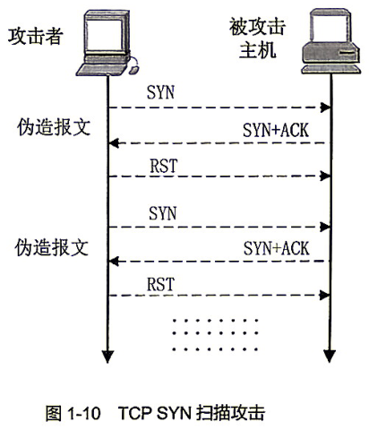
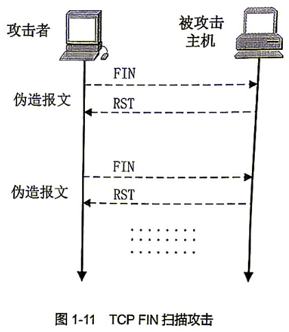
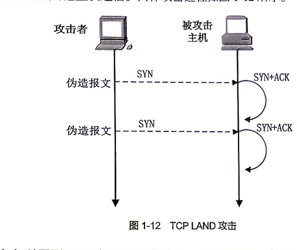
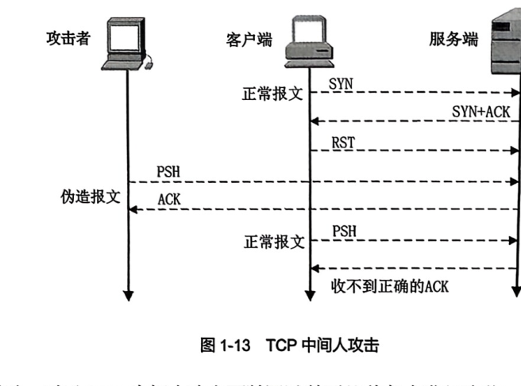

# TCP安全

**课本原文（P30）**
> TCP是一种面向连接的、可靠的、基于字节流的传输层通信协议。TCP攻击是指利用TCP的设计缺陷或漏洞，对目标主机或网络进行攻击的行为。

**要点**
- TCP 特征：3 次握手建立连接、4 次挥手断开、拥塞控制。
- **6 类 TCP 攻击**：
  1. **TCP SYN 泛洪**：伪造大量 SYN 不回应 ACK，耗尽资源 → [[拒绝服务]]（防御：防火墙、SYN Cookie、限制连接数）。
  2. **TCP SYN 扫描**：SYN→收到 SYN+ACK 即发 RST，无痕迹探测开放端口。
  3. **TCP FIN 扫描**：发 FIN，闭合端口回 RST，无连接建立。
  4. **TCP LAND**：源 IP = 目的 IP = 目标主机，自环死循环崩溃。
  5. **TCP 中间人**：会话劫持（窃取序列号/确认号伪造数据包冒充）+ 连接重置（伪造 RST 断开连接，对长连接有杀伤力）。
  6. TCP 连接重置攻击。
- 防御共性：防火墙过滤、SYN Cookie、限制连接数、关闭不常用服务、IDS/IPS。

　　　

**关联**
[[拒绝服务]] · [[防火墙]] · [[信息包筛选]] · [[ARP安全]] · [[DNS安全]]
