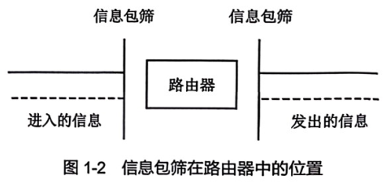

# 信息包筛选

**课本原文（P14）**
> 信息包筛选是常驻于路由器或专用主计算机系统（通常在两个网络之间）的数据库规则，它审查网络通信并决定是否允许该信息通过。

**要点**
- 准则：一组逻辑规则（筛选规则），如"9:00–17:00 允许主机 A 和 B 之间的全部 Telnet 通过"。
- 传统工具只查源/目的 IP、包类型、目的端口（查不了源端口）→ 效率不高。
- 扼流点：全部信息必经的通信点，便于监视记录、实施策略。
- 防**地址欺骗**：在进入路由器的线路上筛选进入的信息包。
- 缺点：① 不能保留已通过信息包的详细信息（无状态，UDP 无法区分请求/响应）② 规则易矛盾、次序歧义（"已允许范围"重叠）③ 规则越复杂越可能出漏洞。
- 位置：路由器（最常用）或主计算机系统；路由器筛选会降低速度。

**关联**
[[防火墙]] · [[应用中继器]] · [[DMZ]] · [[网络分段]] · [[TCP安全]]
