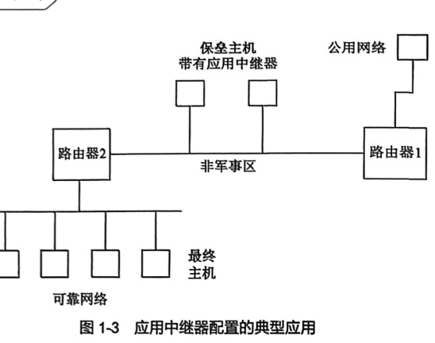

# 应用中继器

**课本原文（P15）**
> 通常，每一项服务程序和应用程序（例如FTP、E-mail或者Telnet）需要安装在最终主机和网关主机上……不转发来自内部网络中的IP信息包；全部发出的信息包都有应用中继器的地址，从而可以有效地隐藏内部网络的拓扑结构。

**要点**
- 也称**应用网关 / 堡垒主机**：最终主机请求服务时，服务程序连接到堡垒主机，由堡垒主机向外连接。
- 优点：无复杂规则集、隐藏内网拓扑（被盗用时暴露信息少）、便于在堡垒主机记录分析进出信息。
- 缺点：对最终用户**不透明**、速度可能下降、可用软件受维护资源限制、长期看设备多而复杂。
- 部署位置：两个路由器之间的安全网络 = [[DMZ]]。

**关联**
[[防火墙]] · [[信息包筛选]] · [[DMZ]] · [[网络安全]]
