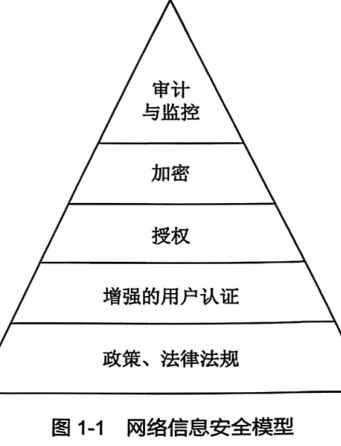

# 网络信息安全模型

**课本原文（P13）**
> 网络信息安全系统并非局限于通信保密、对信息加密等技术问题，它是涉及方方面面的一项极其复杂的系统工程。

**要点（金字塔 5 层，自底向上）**
1. **政策、法律法规**——安全基石，建立安全管理标准。
2. **增强的用户认证**——技术措施首道防线，目的是提供访问控制（[[认证]]三方法）。
3. **授权**——给特许用户合适权限，监控不越权。
4. **加密**——满足认证、一致性、隐秘性、不可抵赖。
5. **审计与监控**——系统安全最后一道防线，含数据备份（问题再现、责任追查、数据恢复）。

> 底层是保障上层的基础，5 个部分相辅相成、缺一不可。

**关联**
[[加密]] · [[认证]] · [[授权]] · [[网络安全]] · [[风险评估]] · [[网络安全风险管理]]
